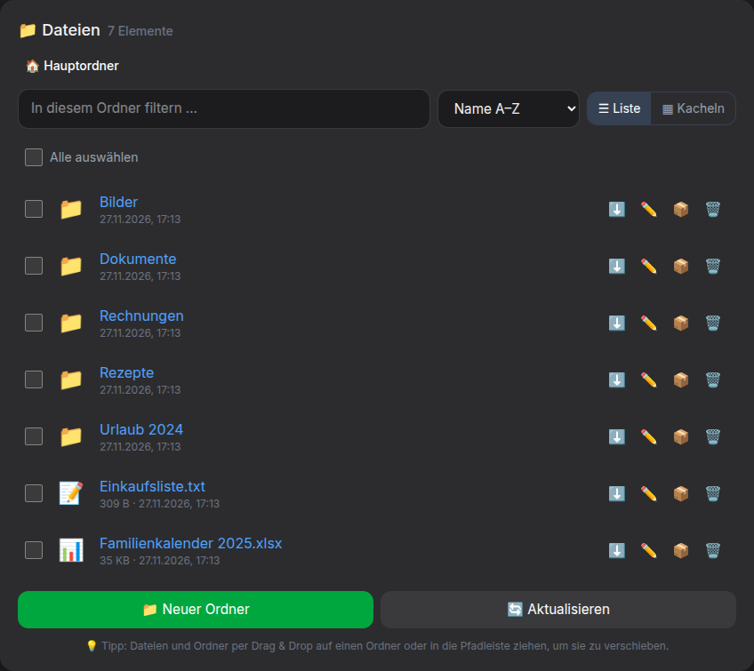
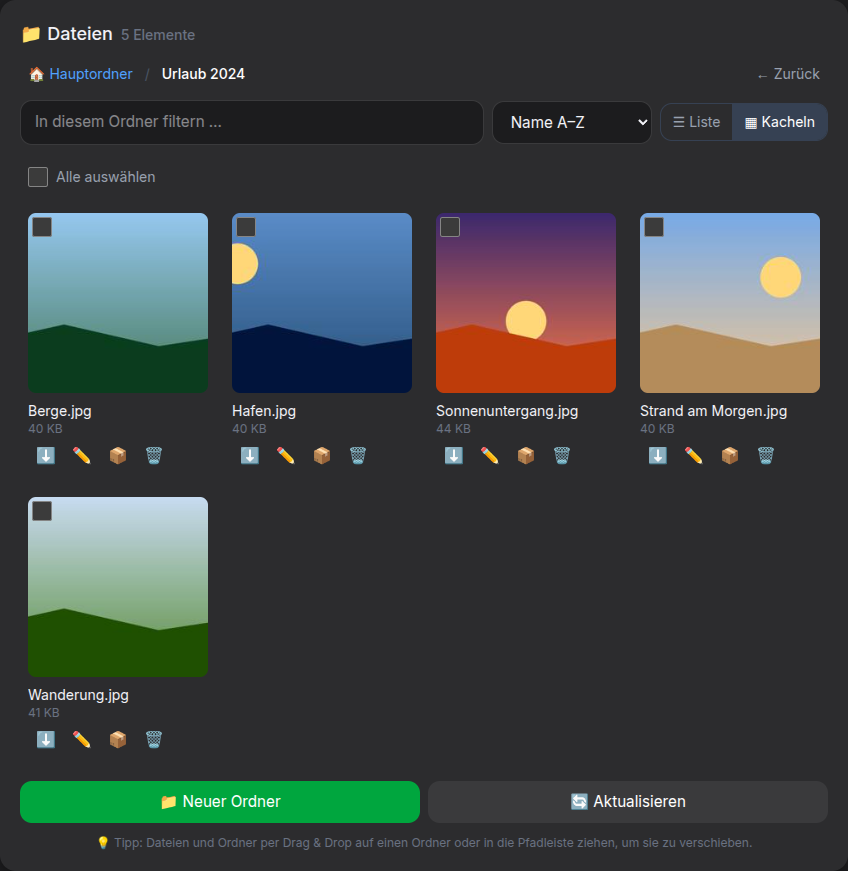
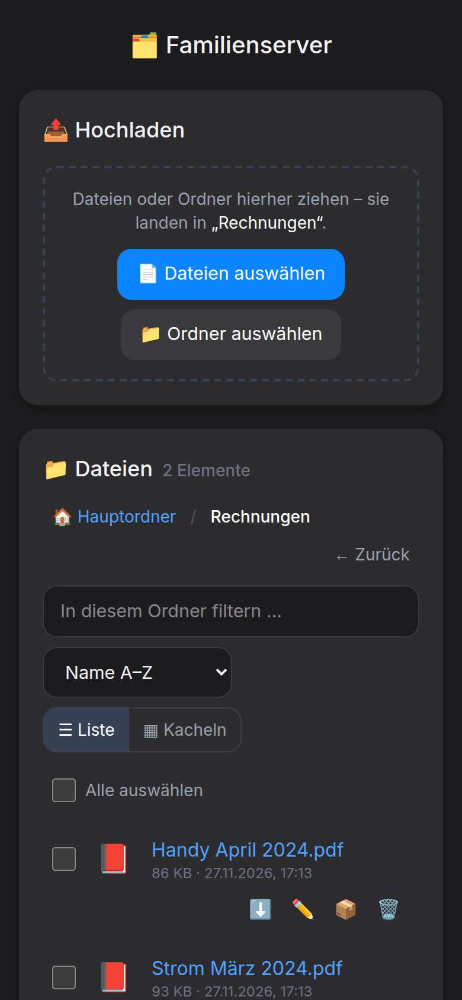

# 🗂️ Familienserver

**Die gemeinsame Ablage für die ganze Familie – im eigenen Heimnetz statt in der Cloud.**

Fotos, Rechnungen, Zeugnisse und Rezepte an einem Ort: hochladen, ordnen, wiederfinden. Der Familienserver läuft auf einem Raspberry Pi (ab 3B), einem alten Laptop oder per Docker. Bedient wird er im Browser, am PC genauso wie auf Handy oder Tablet.

<p align="center">
  
  
</p>

**Inhalt:** [Funktionen](#-funktionen) · [Schnellstart](#-schnellstart) · [Bedienung](#-bedienung) · [Betrieb](#-betrieb) · [Umstieg von Version 1](#-umstieg-von-version-1) · [Entwicklung](#-entwicklung) · [Hilfe](#-hilfe)

---

## ✨ Funktionen

| | |
|---|---|
| 📤 **Hochladen** | Dateien oder ganze Ordner, per Knopf oder Drag & Drop. Nichts wird überschrieben, ein zweites „foto.jpg“ heißt automatisch „foto (1).jpg“ |
| 📁 **Ordnen** | Ordner anlegen, umbenennen, verschieben (per Klick oder durch Ziehen), mehrere Dateien auf einmal bearbeiten |
| 🖼️ **Ansehen** | Liste oder Kacheln mit Vorschaubildern. Fotos als Galerie, dazu Videos, Musik, PDFs und Texte direkt im Browser |
| 🔍 **Finden** | Suche in allen Ordnern mit normalen Sätzen: „Zeige mir alle PDFs von 2024“, „Bilder vom Urlaub“ |
| 🗑️ **Papierkorb** | Gelöschtes lässt sich 30 Tage lang wiederherstellen |
| ⬇️ **Herunterladen** | Einzelne Dateien, ganze Ordner oder eine Auswahl als ZIP, auch sehr große Ordner |
| 🔒 **Geschützt** | Gemeinsames Familien-Passwort, alles bleibt im Heimnetz |
| 💾 **Gesichert** | Skript für automatische Sicherungen auf eine zweite Festplatte |
| 📊 **Überblick** | Auslastung, freier Speicherplatz und CPU-Temperatur des Servers |

---

## ⚡ Schnellstart

**Du brauchst:** Linux (z. B. Raspberry Pi OS), **Python 3.9+** und **Node.js 20+**. Node wird nur zum einmaligen Bauen der Oberfläche gebraucht. Auf dem Raspberry Pi geht es auch ohne, siehe [Anleitung für den Raspberry Pi](docs/raspberry-pi.md).

```bash
git clone https://github.com/Christian-Alexander141/Famielenserver.git
cd Famielenserver
./start.sh start
```

Beim ersten Start fragt das Skript nach einem **Familien-Passwort** (mindestens 8 Zeichen). Danach richtet es alles Nötige ein und zeigt die Adresse an, unter der der Server im Heimnetz erreichbar ist, z. B. `http://192.168.178.50:5000`.

Damit der Server nach jedem Neustart automatisch läuft:

```bash
./start.sh service
```

> 🍓 Ausführliche Anleitung für den Raspberry Pi (feste IP, USB-Festplatte, Firewall): **[docs/raspberry-pi.md](docs/raspberry-pi.md)**
> 🐳 Mit Docker: **[docs/docker.md](docs/docker.md)** · 🔧 Schritt für Schritt ohne Skript: **[docs/manuelle-installation.md](docs/manuelle-installation.md)**

---

## 👪 Bedienung

Diesen Abschnitt kannst du an die Familie weitergeben.



1. **Öffnen:** Im Browser die Adresse des Servers aufrufen und das Familien-Passwort eingeben. Die Anmeldung bleibt 30 Tage gespeichert.
   *Tipp fürs Handy:* Im Browsermenü „Zum Startbildschirm hinzufügen“ wählen. Dann gibt es ein eigenes App-Symbol.
2. **Hochladen:** In den gewünschten Ordner wechseln und auf **Dateien auswählen** oder **Ordner auswählen** tippen. Am PC kannst du Dateien einfach ins Fenster ziehen.
3. **Ordnen:** Auf dem Handy und in der Kachelansicht öffnet **⋯** neben einer Datei das Menü mit **Herunterladen**, **Umbenennen**, **Verschieben** und **In den Papierkorb**. Am PC erscheinen dieselben Aktionen als Symbole rechts in der Zeile, sobald die Maus darauf zeigt. Dort kannst du Dateien auch auf einen Ordner oder auf die Pfadleiste oben ziehen. Für mehrere Dateien vorne die Häkchen setzen.
4. **Ansehen:** Ein Tipp auf ein Foto, Video oder PDF öffnet die Vorschau. Mit **Zurück** und **Weiter** (am PC auch mit den Pfeiltasten) blätterst du durch den Ordner. Die Ansicht **Kacheln** zeigt Vorschaubilder.
5. **Finden:** Unter **Dateisuche** einfach fragen, z. B. „Rechnungen März“ oder „Fotos vom Geburtstag“.
6. **Löschen und zurückholen:** Gelöschtes landet im **Papierkorb** (unten auf der Seite). Dort lässt sich alles 30 Tage lang mit **Wiederherstellen** zurückholen.

Die Adresse in der Browserzeile zeigt den geöffneten Ordner (z. B. `…/#/Urlaub 2024`). Lesezeichen und die Zurück-Taste funktionieren deshalb wie gewohnt. Hell oder dunkel richtet sich die Oberfläche nach der Einstellung des Geräts.

<br clear="right">

---

## 🧰 Betrieb

### Befehle

| Befehl | Wirkung |
|---|---|
| `./start.sh` | Menü mit allen Optionen |
| `./start.sh start` | Server starten |
| `./start.sh service` | Als Systemdienst einrichten (Autostart beim Booten) |
| `./start.sh password` | Familien-Passwort ändern. Alle Geräte müssen sich danach neu anmelden |
| `./start.sh build` | Oberfläche neu bauen (nach Updates) |
| `./backup.sh <Ziel>` | Datensicherung, siehe unten |

Beim Systemdienst: `sudo systemctl status familienserver` zeigt den Zustand, `sudo systemctl restart familienserver` startet ihn neu.

### Einstellungen

Alle Einstellungen stehen in der Datei `.env` im Projektordner. Eine kommentierte Vorlage ist [.env.example](.env.example). Nach Änderungen den Server neu starten.

| Variable | Standard | Bedeutung |
|---|---|---|
| `FAMILIENSERVER_PASSWORD` | – (Pflicht) | Gemeinsames Passwort, mindestens 8 Zeichen |
| `FAMILIENSERVER_DATA_DIR` | `./data` | Wo die Dateien liegen, z. B. auf einer USB-Festplatte |
| `FAMILIENSERVER_TRASH_DAYS` | `30` | Tage im Papierkorb (`0` = bis zum manuellen Leeren) |
| `FAMILIENSERVER_MAX_UPLOAD_MB` | `4096` | Maximale Größe pro Datei |
| `FAMILIENSERVER_LOG_DIR` | `./logs` | Ordner für Protokolle |
| `FAMILIENSERVER_SECURE_COOKIES` | `0` | `1`, wenn der Server per HTTPS erreichbar ist |
| `FAMILIENSERVER_TRUST_PROXY` | `0` | Anzahl vorgeschalteter Reverse Proxys (nginx, Caddy) |
| `PORT` | `5000` | Port des Servers (nur für `start.sh`) |

### Daten und Datensicherung

Alle Familiendateien liegen im Datenordner (Standard `./data`). Der versteckte Unterordner `.familienserver/` enthält Papierkorb und Vorschaubilder. Der Datenordner ist **das Einzige, was gesichert werden muss**.

Der Papierkorb schützt vor versehentlichem Löschen, aber nicht vor einer kaputten Festplatte. Dafür gibt es `backup.sh`. Es legt bei jedem Lauf eine datierte Kopie auf einem **anderen** Datenträger an und behält die letzten 14. Unveränderte Dateien werden nicht doppelt gespeichert, deshalb braucht jede weitere Sicherung nur Platz für das, was sich geändert hat.

```bash
./backup.sh /media/usb/familienserver-backup

# täglich um 3 Uhr automatisch (crontab -e):
0 3 * * * /home/pi/Famielenserver/backup.sh /media/usb/familienserver-backup
```

**Wiederherstellen:** Jede Sicherung ist ein normaler Ordner. Einfach die gewünschten Dateien aus z. B. `/media/usb/familienserver-backup/2026-11-27_0300/` zurückkopieren.

### Protokolle

Alle Protokolle landen im Ordner `logs/`. Er steht in der `.gitignore` und kommt nie ins Repository.

| Datei | Inhalt |
|---|---|
| `familienserver.log` | Meldungen des Servers, z. B. Fehler und fehlgeschlagene Anmeldungen. Ab 1 MB beginnt eine neue Datei, die letzten 5 bleiben erhalten |
| `gunicorn.log` | Start, Stopp und Abstürze des Servers |
| `backup.log` | Jeder Lauf von `backup.sh` |
| `frontend-dev.log` | Ausgabe des Next.js-Entwicklungsservers (nur `./start.sh dev`) |

### Sicherheit

- **Familien-Passwort:** Nach 10 Fehlversuchen wird die Anmeldung für 15 Minuten gesperrt.
- **Eingaben werden geprüft:** Pfad-Tricks wie `../` werden blockiert, fremde Webseiten können keine Aktionen auslösen (CSRF-Schutz), und hochgeladene HTML- oder SVG-Dateien werden nie im Browser ausgeführt.
- **Daten getrennt vom Programm:** Die Familiendateien liegen außerhalb des Programmordners und gelangen nie ins Git-Repository.
- ⚠️ **Nicht per Portfreigabe ins Internet stellen.** Für den Zugriff von unterwegs ein VPN nutzen, z. B. WireGuard (in vielen Routern eingebaut) oder Tailscale.

### Updates

```bash
git pull
./start.sh build
sudo systemctl restart familienserver
```

Die Oberfläche liegt im Ordner `frontend/` (bis November 2026 hieß er `familienserver/`). Bei älteren Installationen übernimmt `./start.sh` einen vorhandenen Build und räumt den alten Ordner von selbst auf.

---

## 🔄 Umstieg von Version 1

| Was | Vorher | Jetzt |
|---|---|---|
| Adresse | `http://<IP>:3000` | `http://<IP>:5000`. Lesezeichen und Firewall-Regeln anpassen |
| Anmeldung | keine | Familien-Passwort, `./start.sh` fragt beim ersten Start danach |
| Dateien | `familienserver/public/uploads` | `data/`, wird beim ersten Start automatisch umgezogen |
| Löschen | sofort endgültig | erst in den Papierkorb |
| Dienste | Backend- und Frontend-Dienst | ein Dienst, siehe [Raspberry-Pi-Anleitung](docs/raspberry-pi.md#autostart) |
| Python-Pakete | `requirements.txt` | `pyproject.toml` (installiert `start.sh` automatisch) |
| `NEXT_PUBLIC_API_BASE_URL` | nötig | entfällt |

---

## 💻 Entwicklung

```bash
./start.sh dev                          # Backend + Oberfläche mit automatischem Neuladen → http://localhost:3000
venv/bin/pip install -e ".[dev]"        # Abhängigkeiten inkl. pytest (aus pyproject.toml)
venv/bin/python -m pytest               # Backend-Tests
cd frontend && npm run lint             # Oberfläche prüfen
```

Bei jedem Push prüft die [CI](.github/workflows/ci.yml) Tests, Typen, Lint und Build.

**Aufbau:** Die Oberfläche (Next.js) wird als statische Seite nach `frontend/out` gebaut. Im Betrieb liefert das Flask-Backend sie zusammen mit der API aus. Das ist ein Prozess auf einem Port, und auf dem Pi läuft kein Node.js mit. Im Entwicklungsmodus leitet Next.js `/api/*` an das Backend auf `127.0.0.1:5000` weiter.

```
Famielenserver/
├── backend/            Flask-Backend
│   ├── __init__.py       App, Fehlerbehandlung, Protokolle, Auslieferung der Oberfläche
│   ├── api.py            REST-API unter /api
│   ├── auth.py           Anmeldung, CSRF-Schutz, Sperre bei Fehlversuchen
│   ├── config.py         Einstellungen aus .env bzw. Umgebungsvariablen
│   ├── storage.py        Dateizugriff, Pfadprüfung, Papierkorb
│   ├── search.py         Dateisuche
│   ├── system.py         CPU/RAM/Speicher/Temperatur
│   ├── thumbnails.py     Vorschaubilder (Pillow)
│   └── zipstream.py      ZIP-Download ohne Zwischenspeicher
├── frontend/           Next.js-Oberfläche, Aufbau siehe frontend/README.md
├── tests/              Backend-Tests (pytest): Sicherheit, Dateien, Papierkorb, App
├── docs/               Anleitungen (Raspberry Pi, Docker, manuelle Installation), Screenshots
├── start.sh            Einrichten und Starten
├── backup.sh           Datensicherung
├── server.py           Einfacher Entwicklungsserver (python server.py)
├── pyproject.toml      Python-Abhängigkeiten
├── Dockerfile, docker-compose.yml
├── data/               Familiendateien    ┐
└── logs/               Protokolle         ┘ nicht im Repository
```

<details>
<summary><strong>API-Überblick</strong></summary>

Alle Endpunkte außer `/api/health`, `/api/session` und `/api/login` erfordern eine Anmeldung. Ändernde Anfragen (POST) brauchen den Header `X-Familienserver: 1`.

| Methode | Pfad | Zweck |
|---|---|---|
| GET | `/api/files?path=` | Ordnerinhalt |
| POST | `/api/upload?dir=&name=` | Datei hochladen (Inhalt als Body, `name` darf Unterordner enthalten) |
| GET | `/api/download?path=[&inline=1]` | Datei herunterladen bzw. anzeigen |
| GET | `/api/zip?path=&path=…` | Ordner oder Auswahl als ZIP |
| GET | `/api/thumbnail?path=` | Vorschaubild |
| POST | `/api/mkdir` `{parent, name}` | Ordner anlegen |
| POST | `/api/rename` `{path, name}` | Umbenennen |
| POST | `/api/move` `{path, destination}` | Verschieben (`destination` = Zielordner) |
| POST | `/api/delete` `{path}` | In den Papierkorb |
| GET | `/api/trash` | Inhalt des Papierkorbs |
| POST | `/api/trash/restore`, `/api/trash/delete` `{id}`, `/api/trash/empty` | Wiederherstellen, endgültig löschen, leeren |
| POST | `/api/search` `{query}` | Suche |
| GET | `/api/system` | Systemauslastung |

</details>

---

## 🆘 Hilfe

| Problem | Lösung |
|---|---|
| Seite lädt nicht von anderen Geräten | Läuft der Server (`sudo systemctl status familienserver`)? Richtige IP und Port 5000? Firewall? |
| „Kein Passwort gesetzt“ | `./start.sh password` |
| „Das Frontend ist noch nicht gebaut“ | `./start.sh build` |
| Passwort vergessen | `./start.sh password` setzt ein neues |
| Upload bricht bei großen Dateien ab | `FAMILIENSERVER_MAX_UPLOAD_MB` erhöhen, freien Speicherplatz prüfen |
| Was ist schiefgelaufen? | `logs/familienserver.log` und `logs/gunicorn.log` ansehen |

Weitere Lösungen stehen in der [Raspberry-Pi-Anleitung](docs/raspberry-pi.md#-häufige-probleme) und der [manuellen Installation](docs/manuelle-installation.md#häufige-probleme).

---

## 🤝 Mitwirken

Fehler und Ideen gerne als Issue, Verbesserungen als Pull Request.

## 📜 Lizenz

Dieses Projekt ist für den **persönlichen Gebrauch** gedacht.
